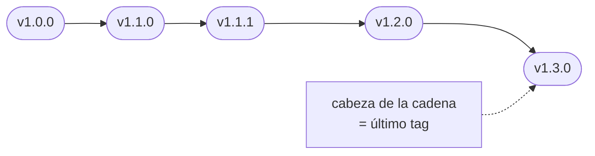
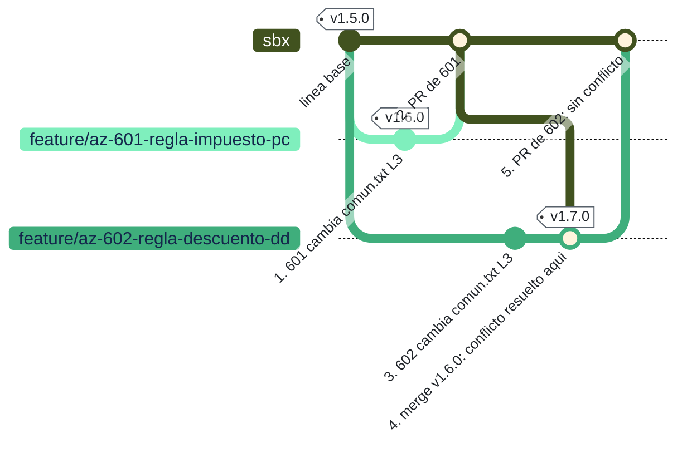
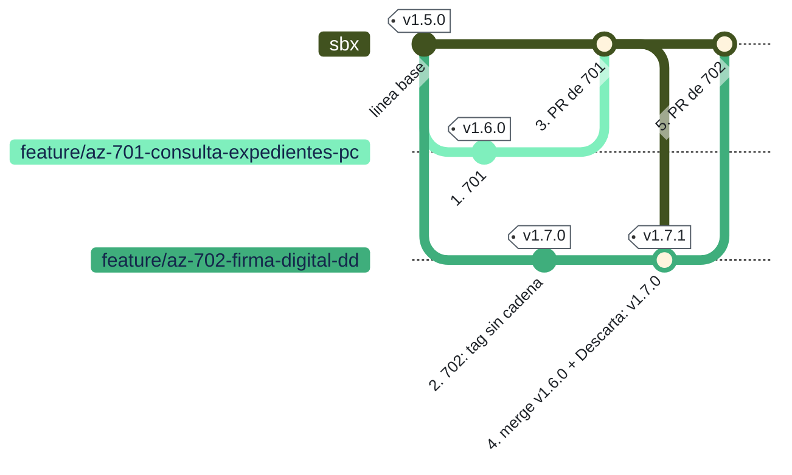
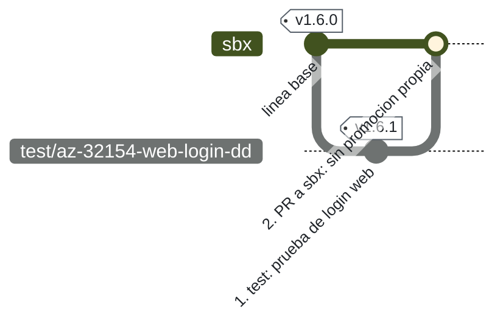

# Estrategia de ramificación SigDoc — guía por caso

**Versión 1.8 · 2026-10-13**
- 1.8: se reasignan tres colores: `sbx` pasa a verde oliva, `bug/` a vinotinto y `prod` a celeste (el resto no cambia). La sección 8 nombra al responsable del proyecto.
- 1.7: la nomenclatura tiene cinco partes (decía cuatro; el esquema ya mostraba cinco: tipo, sistema, ID, descripción e iniciales). Los colores de las ramas y de los diagramas pasan a ser los del sitio de documentación: celeste, aguamarina, verde oliva, naranja quemado, gris, amarillo, morado y vinotinto.
- 1.6: coherencia con el sitio de documentación: el aviso «Importante» del hotfix (5.2) cita los pasos 7 a 9 de la tabla (5 a 7 de la lista «Pasos»), y en el defecto (4) el paso 1–2 remite al «Flujo de requerimiento».
- 1.5: rollback (6.5): el PR a `sbx` va antes de promover a qa, igual que en el hotfix (I2); el diagrama y la tabla se corrigen. En 5.2 se aclara que, con qa libre, el recorrido normal también empieza por el PR a `sbx`. La validación automática deja de aceptar (antes avisaba) un hotfix en qa que aún no está en `sbx`.
- 1.4: en los diagramas de ramas, la regla de cadena y las promociones a qa, stg y prod se dibujan saliendo de `sbx` (que en ese momento ya es igual al tag), no de la rama de trabajo. El hotfix y el rollback hacia stg y prod siguen saliendo de su rama, porque `sbx` aún no tiene la corrección (secciones 1, 3, 4, 5, 6).
- 1.3: validación automática de PR (sección 7 y [CONFIGURAR-AZURE-DEVOPS.md](CONFIGURAR-AZURE-DEVOPS.md)); en el hotfix, el PR a sbx va antes de promover a qa (5.2); los tags descartados se declaran con `Descarta:` (R10).
- 1.2: una sola forma de nombre para todas las ramas de trabajo: `<tipo>/<sistema>-<id>-<descripcion>-<iniciales>` (`feature/`, `bug/`, `hotfix/`, `test/`); sin sprint.

Esta guía complementa **DES-EST-016 v2** (Estándar control de código fuente) y **ARQ-PRO-001 v1** (Procedimiento control de versiones). Donde esos documentos se contradicen o no cubren un caso, se aplica lo que dice esta guía; la sección 9 lista cada diferencia. Cada regla se probó en la prueba de concepto ([POC-RAMAS.md](POC-RAMAS.md)), cuya evidencia está en `evidencia\<escenario>\`.

---

## 0. Resumen en una página

| ¿Qué pasó? | Rama | Nace de | Versión del tag | Recorrido |
|---|---|---|---|---|
| **Requerimiento** (historia de usuario nueva) | `feature/az-<idHU>-<descripcion>-<ini>` | Último tag | Sube el **minor**: `v1.5.0` | PR a sbx → qa → stg → prod |
| **Defecto** (QA rechaza una versión; bug en Azure DevOps) | `bug/az-<idBug>-<descripcion>-<ini>` | Último tag | Sube el **patch**: `v1.5.1` | PR a sbx → qa → stg → prod |
| **Incidencia no urgente** (reportada en producción por GLPI, sale en la próxima entrega) | `bug/glpi-<ticket>-<descripcion>-<ini>` | Último tag | Patch | PR a sbx → qa → stg → prod |
| **Incidencia urgente — hotfix** | `hotfix/glpi-<ticket>-<descripcion>-<ini>` | **Tag de producción** | **Cuarta posición**: `v1.4.0.1` | stg → prod; después se re-etiqueta la cabeza de la cadena, PR a sbx y el tag re-etiquetado sube a qa |
| Rechazo en stg | `bug/az-<idBug>-<descripcion>-<ini>` | Último tag | Patch | PR a sbx → qa → stg → prod |
| Versión certificada que espera al cliente mientras otra debe salir | `feature/az-<id del ítem nuevo>-<descripcion>-<ini>` | Último tag | Según contenido | Retiro temporal con `git revert` |
| Requerimiento cancelado | `feature/az-<id del ítem nuevo>-<descripcion>-<ini>` | Último tag | Patch | PR a sbx → qa → stg → prod |
| Rollback de producción | `hotfix/glpi-<ticket>-<descripcion>-<ini>` | Tag de producción | Cuarta posición | Igual que un hotfix |
| Prueba automatizada | `test/az-<id>-<desk\|web\|serv>-<descripcion>-<ini>` | Último tag | Patch | PR a sbx (sección 6.11) |
| Promoción de una versión | `promote/<tag>-to-<qa\|stg\|prod>` | El tag | — | PR al ambiente; la rama se borra al terminar |

Tres reglas sostienen todo lo demás:

1. **Toda rama de trabajo nace de un tag** (nunca de la rama `sbx`). El hotfix nace del tag que está en producción; el resto, del último tag.
2. **Antes de crear un tag, la rama incorpora el último tag existente** (regla de cadena).
3. **El tag se crea en la rama de trabajo, antes de completar el PR a sbx.**

---

## 1. Conceptos que hay que tener claros

**Un tag no "vive" en un ambiente.** Un tag (`v1.5.0`) es una etiqueta permanente pegada a un commit del historial compartido. Cuando decimos "qa tiene v1.5.0", queremos decir que la rama `qa` tiene exactamente el mismo contenido que ese commit. Por eso, crear una rama "desde el tag que está en qa" no es sacar nada de qa: es partir de una foto del historial que qa también tiene.

**Las ramas de ambiente solo avanzan.** Promover hace un *merge* del tag en la rama del ambiente, y git sabe juntar, no reemplazar. Si el tag nuevo no contiene lo que el ambiente ya tiene, pasa una de dos cosas:
- con *fast-forward*, el PR se bloquea;
- con *merge* normal, el ambiente queda con una **mezcla que no corresponde a ningún tag**.

La PoC lo mostró en los escenarios 2 y 5b. De ahí sale la regla más importante de esta guía.

**Cadena de tags.** Si cada tag nuevo contiene al anterior, los tags forman una cadena:

Cada flecha se lee "está contenido en": `v1.1.0` contiene todo `v1.0.0`, `v1.1.1` contiene todo `v1.1.0`, y así sucesivamente.
Con la cadena, cualquier tag nuevo es la continuación de lo que tienen los ambientes, y cada promoción deja el ambiente **idéntico** al tag. La **cabeza de la cadena** es el último tag: el de mayor versión, que contiene a todos los demás.

**Arriba y abajo.** El orden es `sbx` (abajo) → `qa` → `stg` → `prod` (arriba). Lo prohibido es llevar algo de un ambiente superior a uno inferior; por ejemplo, un merge de `qa` en `sbx`. Incorporar un tag o `sbx` en tu rama de trabajo **no** es bajar, porque son la base de la que partes.

**Qué viaja en cada dirección:**

```mermaid
flowchart LR
    C["commits en la<br/>rama de trabajo"] --> T(["1. tag vX.Y.Z<br/>en la rama"])
    T -->|"2. PR"| SBX["sbx<br/>= vX.Y.Z"]
    SBX -->|"3. promote/vX.Y.Z-to-qa"| QA["qa<br/>= vX.Y.Z"]
    QA -->|"4. promote/vX.Y.Z-to-stg<br/>cuando QA certifica"| STG["stg<br/>= vX.Y.Z"]
    STG -->|"5. promote/vX.Y.Z-to-prod<br/>con aprobación"| PROD["prod<br/>= vX.Y.Z"]
    classDef trabajo fill:#7FEFBD,color:#14264B,stroke:#1F9467
    classDef tag fill:#ffffff,color:#1f2328,stroke:#57606a,stroke-width:2px
    classDef sbx fill:#41521F,color:#FFFFFF,stroke:#41521F
    classDef qa fill:#FFA400,color:#14264B,stroke:#B36F00
    classDef stg fill:#2A2A72,color:#FFFFFF,stroke:#2A2A72
    classDef prod fill:#6CD4FF,color:#14264B,stroke:#1E88B8
    class C trabajo
    class T tag
    class SBX sbx
    class QA qa
    class STG stg
    class PROD prod
```

- **Primero el tag, después el PR.** El tag se crea en la rama de trabajo (paso 1), y esa rama ya etiquetada entra a `sbx` por PR (paso 2).
- **La versión sube por los ambientes en orden** qa → stg → prod (pasos 3 a 5). Las flechas muestran ese orden, pero cada promoción se hace **desde el tag** (`promote/vX.Y.Z-to-…`), no copiando el ambiente anterior. Por eso cada caja dice `= vX.Y.Z`: los cuatro terminan con exactamente la misma versión.
- Nada sale de qa, stg o prod hacia otra rama.

**Cómo leer los diagramas de ramas de esta guía** (los de tipo *gitGraph*):
- Cada línea horizontal es una rama. Su nombre aparece a la izquierda, y el **color dice qué tipo de rama es** (igual en todos los diagramas):

  | Color | Rama |
  |---|---|
  | 🟩 verde oliva | `sbx` (línea base) |
  | 🟩 aguamarina (varios tonos si hay varias) | `feature/` (requerimiento) |
  | 🟥 vinotinto | `bug/` (defecto o incidencia no urgente) |
  | 🟧 naranja quemado | `hotfix/` (incidencia urgente o rollback) |
  | ⬛ gris | `test/` (prueba automatizada) |
  | 🟨 amarillo | `qa` |
  | 🟪 morado | `stg` |
  | 🟦 celeste | `prod` |

  *Son los colores del sitio de documentación. Los cuadrados de las tablas son aproximados: no existe un cuadrado verde oliva, aguamarina ni gris medio, así que `sbx` y `feature/` comparten 🟩 y `test/` usa ⬛. Cada cuadrado va siempre junto al nombre de la rama, que es lo que la identifica.*
- Cada commit lleva un **número de paso** (`1.`, `2.`, …). Debajo de cada diagrama hay una tabla con los mismos números que explica qué se hace en cada paso. Si las etiquetas se cruzan en el dibujo, guíese por los números y la tabla.
- Cada círculo es un commit. La etiqueta en recuadro es el tag (`v1.6.0`).
- Cuando una línea se junta con otra, es un merge: un PR completado. En las ramas de ambiente, el texto del círculo dice qué promoción fue (`promote/v1.6.0-to-qa`).
- La regla de cadena (`git merge v1.5.1`) y las promociones a qa, stg y prod se dibujan saliendo de `sbx`, que en ese momento ya es igual al tag: es el mismo commit que nombra el comando. La excepción es el hotfix hacia stg y prod (5.2) y el rollback (6.5): como `sbx` todavía no tiene la corrección, esas líneas salen de la rama del hotfix.
- Un círculo con una ✕ es un `git revert`. Un cuadrado marca un commit destacado: en esta guía, el "revert del revert" que devuelve algo retirado.
- Las etiquetas inclinadas bajo cada círculo describen el commit. En las ramas de ambiente, todo círculo es una promoción.
- Los diagramas se ven en VS Code con la extensión *Markdown Preview Mermaid Support*, y en cualquier visor que soporte Mermaid.

---

## 2. Reglas generales

| # | Regla | Por qué |
|---|---|---|
| R1 | `sbx`, `qa`, `stg` y `prod` están protegidas: **sin push directo**, todo entra por PR con revisión. La única excepción es el commit inicial al crear el repositorio. | Trazabilidad y revisión obligatoria (ARQ-PRO-001 §5). |
| R2 | Toda rama de trabajo nace de un tag: `git checkout tags/<tag> -b <rama>`. El hotfix nace del tag de producción; todo lo demás, de la **cabeza de la cadena**. | Así nunca se arrastra código que no pertenece a ninguna versión (PoC 3 y 4). |
| R3 | **Regla de cadena.** Antes de crear el tag, la rama incorpora el último tag (`git merge <último tag>`). Si hay conflicto, se resuelve en la rama de trabajo. | Mantiene una sola cadena y evita mezclas en los ambientes (PoC 5b, 12). |
| R4 | El tag se crea **en la rama de trabajo, antes de completar el PR** a sbx. Lo crea o lo valida el líder técnico (DES-EST-016 §4.1). Siempre es un tag anotado (`git tag -a ... -m`). | La versión contiene solo lo que se probó (PoC 3b y 4b frente a 3a y 4a). |
| R5 | PR de la rama de trabajo a `sbx`. Con R2–R4, `sbx` queda siempre con el mismo contenido que el último tag. | sbx deja de tener "cosas sueltas" sin versión (PoC 12). |
| R6 | La promoción siempre parte de un tag, con `promote/<tag>-to-<ambiente>`, en orden **qa → stg → prod**. `prod` solo recibe desde `stg`. La rama `promote/` se borra al terminar. | DES-EST-016 §4.12 y ARQ-PRO-001 §6.7–6.11. |
| R7 | La única excepción al orden es el **hotfix**, que entra directo a `stg` (salta qa). | qa suele tener otra versión en pruebas que no debe mezclarse (PoC 2). |
| R8 | `stg` solo recibe versiones aprobadas para salir a producción en esa ventana. Lo que espera la aprobación del cliente **se queda en qa**. Así `stg` es casi siempre igual a `prod` y sirve para validar hotfixes. | Sin esto, un hotfix no tendría dónde validarse (sección 6.8). |
| R9 | Nombres únicos: una rama o un tag nunca se reutilizan. Cada iteración, retiro o reintroducción usa el ID de un ítem nuevo. | DES-EST-016 §4.10 y §4.12 (PoC 4, 9a). |
| R10 | Los tags nunca se mueven ni se borran. Un tag creado por error queda sin usar y se declara en el mensaje del siguiente tag con una línea `Descarta: <tag> (motivo)`. Así la validación automática sabe que no forma parte de la cadena. | Un tag es el registro de lo entregado. |
| R11 | Tipo de merge en Azure DevOps: **solo "Basic merge (no fast-forward)"**. Squash y rebase quedan prohibidos. | Ver sección 7. |

### Nomenclatura

Todas las ramas de trabajo siguen **una sola forma, con cinco partes, en el mismo orden y sin excepciones**:

```
<tipo>/<sistema>-<id>-<descripcion>-<iniciales>
   │       │      │        │             └─ ¿quién?   iniciales en minúscula; varias personas, separadas por guion (pc-dd)
   │       │      │        └─ ¿qué hace?  2 a 5 palabras en minúscula, sin tildes ni conectores
   │       │      └─ ¿qué número?         el ID del ítem en ese sistema
   │       └─ ¿dónde está registrado?     az (Azure DevOps) o glpi
   └─ ¿qué clase de trabajo?              feature, bug, hotfix o test
```

Para armar el nombre se responden esas cinco preguntas, en ese orden. Para leerlo, igual: el nombre de cualquier rama dice qué es, dónde está el ítem, qué número tiene, de qué trata y quién la tiene.

| Clase de trabajo | `<tipo>` | Ejemplo |
|---|---|---|
| Requerimiento (historia de usuario) | `feature` | `feature/az-32154-validacion-tokens-pc` |
| Requerimiento entre dos personas | `feature` | `feature/az-32154-validacion-tokens-pc-dd` |
| Cambio de alcance: retiro temporal, reintroducción, cancelación (ID del **ítem nuevo**) | `feature` | `feature/az-1003-retiro-temporal-hu-1001-pc` |
| Defecto reportado por QA | `bug` | `bug/az-65487-validacion-login-dd` |
| Incidencia no urgente | `bug` | `bug/glpi-13487-calculo-redondeo-pc` |
| Hotfix (incluye rollback) | `hotfix` | `hotfix/glpi-13487-caida-login-pc` |
| Prueba automatizada | `test` | `test/az-32154-web-login-dd` — la **primera palabra** de la descripción es el tipo de componente: `desk`, `web` o `serv` (DES-EST-016 §4.6.5) |

Nombres que **no** son ramas de trabajo y conservan el formato del estándar:

| Clase | Formato | Ejemplo |
|---|---|---|
| Promoción | `promote/<tag>-to-<qa\|stg\|prod>` | `promote/v1.5.0-to-qa` (DES-EST-016 §4.13.7) |
| Ramas de ambiente | `sbx`, `qa`, `stg`, `prod` | — |
| Tag | `vX.Y.Z` o, solo para hotfix, `vX.Y.Z.W` | `v1.5.0`, `v1.4.0.1` |

**Reglas de escritura**
- **Todo en minúsculas**, incluidas las iniciales. En Windows, git no distingue mayúsculas en las carpetas. En la PoC, con una carpeta `Bug/` existente, la rama `bug/az-2-y-dd` se creó como `Bug/az-2-y-dd` sin avisar, y su `git push` falló.
- **Solo letras sin tilde, números y guiones:** sin espacios, tildes ni ñ (`validacion`, `contrasena`). Git acepta tildes, pero no todas las herramientas (pipelines, consolas, URLs) las manejan bien. Es la misma regla que DES-EST-016 §4.4.3 pone a los nombres de componentes.
- **Descripción corta:** de 2 a 5 palabras, sin conectores ni preposiciones ("de", "para", "entre"; DES-EST-016 §4.4.3). El nombre completo no pasa de 60 caracteres: los nombres muy largos dependen de que cada equipo tenga `core.longpaths` activado.
- **El sistema va siempre**, también en `feature` y `test`. Azure DevOps y GLPI numeran por separado y el mismo número puede existir en los dos. Además, un requerimiento que llegue por GLPI se nombra igual (`feature/glpi-…`), sin crear una regla aparte.
- **Nunca crear una rama llamada solo `feature`, `bug`, `hotfix`, `test` o `promote`.** Git no permite que un nombre sea a la vez rama y carpeta: si existe la rama `hotfix`, nadie puede crear `hotfix/...` (comprobado en la PoC).
- **No se incluye el sprint.** El sprint está en Azure Boards y queda obsoleto si la HU pasa a otro sprint; el ID es único.
- **No se incluye la versión base en el hotfix.** El tag del hotfix ya la dice: `v1.4.0.1` es una corrección sobre `v1.4.0`.

**Comprobación automática.** Un nombre es válido si cumple una de estas dos expresiones y no pasa de 60 caracteres. Son las que usa la PoC (I4) y las que usaría la validación de Azure DevOps (sección 7):
```
^(feature|bug|hotfix)/(az|glpi)-[0-9]+(-[a-z0-9]+)+-[a-z]{2,3}$
^test/(az|glpi)-[0-9]+-(desk|web|serv)(-[a-z0-9]+)+-[a-z]{2,3}$
```

**Transición:** las ramas abiertas con el formato anterior (`HU_…`, `BUG_…`, `AUT_…`) terminan con ese nombre; las nuevas usan este.

### Versionado

| El tag contiene… | Qué número sube | Ejemplo desde `v1.5.0` |
|---|---|---|
| Cambios incompatibles (rompen contrato) | Major | `v2.0.0` |
| Al menos un requerimiento nuevo | Minor | `v1.6.0` |
| Solo correcciones: defecto de QA, rechazo en stg, incidencia no urgente, retiro de algo | Patch | `v1.5.1` |
| Hotfix sobre el tag de producción | Cuarta posición sobre el tag de prod | prod = `v1.4.0` → `v1.4.0.1`; el segundo hotfix, `v1.4.0.2` |

El **número de iteraciones de QA** (el objetivo del arquitecto con la cuarta posición) se registra en el **mensaje del tag** y en Azure DevOps, no en el número:
```
git tag -a v1.5.1 -m "v1.5.1: corrige rechazo QA #1 de v1.5.0 (BUG AZ 65487, HU 32154)"
git tag -a v1.5.2 -m "v1.5.2: corrige rechazo QA #2 de v1.5.0 (BUG AZ 65488, HU 32154)"
```
Para contar las iteraciones de una versión: `git tag -l "v1.5.*" -n1`.

---

## 3. Requerimiento (historia de usuario)

**Cuándo:** desarrollo de una funcionalidad nueva.

```mermaid
%%{init: {'theme': 'base', 'gitGraph': {'mainBranchName': 'sbx'}, 'themeVariables': {'git0': '#41521F', 'gitBranchLabel0': '#FFFFFF', 'gitInv0': '#41521F', 'git1': '#7FEFBD', 'gitBranchLabel1': '#14264B', 'gitInv1': '#7FEFBD', 'git2': '#AD343E', 'gitBranchLabel2': '#FFFFFF', 'gitInv2': '#AD343E', 'git3': '#FFA400', 'gitBranchLabel3': '#14264B', 'gitInv3': '#FFA400', 'git4': '#2A2A72', 'gitBranchLabel4': '#FFFFFF', 'gitInv4': '#2A2A72', 'git5': '#6CD4FF', 'gitBranchLabel5': '#14264B', 'gitInv5': '#6CD4FF', 'commitLabelColor': '#1f2328', 'commitLabelBackground': '#ffffff', 'commitLabelFontSize': '13px', 'tagLabelColor': '#1f2328', 'tagLabelBackground': '#ffffff', 'tagLabelBorder': '#57606a', 'tagLabelFontSize': '13px'}} }%%
gitGraph
    commit id: "linea base" tag: "v1.5.0"
    branch qa order: 7
    checkout sbx
    branch stg order: 8
    checkout sbx
    branch prod order: 9
    checkout sbx
    branch feature/az-32154-validacion-tokens-pc order: 1
    commit id: "1. feat: validacion de tokens"
    checkout sbx
    branch bug/az-65490-mensaje-error-dd order: 2
    commit id: "2. otro equipo corrige un bug" tag: "v1.5.1"
    checkout sbx
    merge bug/az-65490-mensaje-error-dd id: "2. PR del bug a sbx"
    checkout feature/az-32154-validacion-tokens-pc
    commit id: "3. feat: pruebas unitarias"
    merge sbx id: "4. regla de cadena: merge v1.5.1" tag: "v1.6.0"
    checkout sbx
    merge feature/az-32154-validacion-tokens-pc id: "5. PR a sbx"
    checkout qa
    merge sbx id: "6. v1.6.0 a qa"
    checkout stg
    merge sbx id: "7. v1.6.0 a stg"
    checkout prod
    merge sbx id: "8. v1.6.0 a prod"
```

| Paso | Rama | Qué se hace | Por qué |
|---|---|---|---|
| — | 🟩 `feature/az-32154-…` | La rama nace del último tag (`v1.5.0`) | R2: nunca de la rama sbx |
| 1 | 🟩 feature | Se desarrolla | — |
| 2 | 🟥 `bug/az-65490-…` | Mientras tanto, otro equipo entrega un bug: tag `v1.5.1` y PR a sbx | Ahora el último tag es `v1.5.1` |
| 3 | 🟩 feature | Se termina el desarrollo (pruebas unitarias) | — |
| 4 | 🟩 feature | **Regla de cadena**: `git merge v1.5.1` en la rama. Después, el tag `v1.6.0` **en la rama** | `v1.6.0` debe contener al último tag (R3), y el tag va antes del PR (R4) |
| 5 | 🟩 sbx | PR de la rama a sbx | sbx queda igual a `v1.6.0` |
| 6 | 🟨 qa | `promote/v1.6.0-to-qa` | QA prueba |
| 7 | 🟪 stg | `promote/v1.6.0-to-stg`, cuando QA certifica y el cliente aprueba | — |
| 8 | 🟦 prod | `promote/v1.6.0-to-prod`, cuando el comité autoriza | — |

**Pasos**

1. Crear la rama desde la cabeza de la cadena:
   ```
   git fetch --all --tags
   git tag --sort=-version:refname          # el primero de la lista es el último tag
   git checkout tags/v1.5.0 -b feature/az-32154-validacion-tokens-pc
   git push -u origin feature/az-32154-validacion-tokens-pc
   ```
2. Desarrollar con commits según DES-EST-016 §4.9 (`feat(api): ...`). Hacer `git push` con frecuencia.
3. Cuando el desarrollo está terminado y pasa las pruebas unitarias, aplicar la **regla de cadena**:
   ```
   git fetch --tags
   git tag --sort=-version:refname          # ¿apareció un tag nuevo, por ejemplo v1.5.1?
   git merge v1.5.1                          # incorporarlo; si hay conflicto, resolverlo aquí
   git push
   ```
4. Crear el tag en la rama (lo crea o lo valida el líder técnico):
   ```
   git tag -a v1.6.0 -m "v1.6.0: HU 32154 validación de tokens. Versión para pruebas QA"
   git push origin v1.6.0
   ```
5. PR `feature/az-32154-validacion-tokens-pc` → `sbx`. Azure ejecuta la validación automática (sección 7) y no deja completar el PR si encuentra un error. Para revisarlo antes de abrir el PR, en el propio clon:
   ```
   & <ruta>\Validar-PR.ps1 -SourceBranch feature/az-32154-validacion-tokens-pc -TargetBranch sbx
   ```
   Al completar el PR, borrar la rama (local y remota).
6. Promover a qa:
   ```
   git checkout tags/v1.6.0 -b promote/v1.6.0-to-qa
   git push -u origin promote/v1.6.0-to-qa
   ```
   Hacer el PR `promote/v1.6.0-to-qa` → `qa`, completarlo y borrar la rama `promote/`.
7. Cuando QA certifica y hay aprobación, promover a stg y después a prod, siempre en ese orden.

**Si el PR a sbx tiene conflicto:** casi siempre es porque se saltó el paso 3. Se vuelve a ese paso: se incorpora el último tag en la rama, se resuelve allí y se crea el tag. Nunca se resuelve en sbx (PoC 6 y 11).

---

## 4. Defecto (QA rechaza una versión)

**Cuándo:** QA prueba `v1.6.0` en qa, encuentra un error y lo registra como bug en Azure DevOps.

```mermaid
%%{init: {'theme': 'base', 'gitGraph': {'mainBranchName': 'sbx'}, 'themeVariables': {'git0': '#41521F', 'gitBranchLabel0': '#FFFFFF', 'gitInv0': '#41521F', 'git1': '#7FEFBD', 'gitBranchLabel1': '#14264B', 'gitInv1': '#7FEFBD', 'git2': '#AD343E', 'gitBranchLabel2': '#FFFFFF', 'gitInv2': '#AD343E', 'git3': '#AD343E', 'gitBranchLabel3': '#FFFFFF', 'gitInv3': '#AD343E', 'git4': '#FFA400', 'gitBranchLabel4': '#14264B', 'gitInv4': '#FFA400', 'git5': '#2A2A72', 'gitBranchLabel5': '#FFFFFF', 'gitInv5': '#2A2A72', 'git6': '#6CD4FF', 'gitBranchLabel6': '#14264B', 'gitInv6': '#6CD4FF', 'commitLabelColor': '#1f2328', 'commitLabelBackground': '#ffffff', 'commitLabelFontSize': '13px', 'tagLabelColor': '#1f2328', 'tagLabelBackground': '#ffffff', 'tagLabelBorder': '#57606a', 'tagLabelFontSize': '13px'}} }%%
gitGraph
    commit id: "linea base" tag: "v1.5.0"
    branch qa order: 7
    checkout sbx
    branch stg order: 8
    checkout sbx
    branch prod order: 9
    checkout sbx
    branch feature/az-32154-validacion-tokens-pc order: 1
    commit id: "1. feat: validacion de tokens" tag: "v1.6.0"
    checkout sbx
    merge feature/az-32154-validacion-tokens-pc id: "2. PR a sbx"
    checkout qa
    merge sbx id: "3. v1.6.0 a qa: rechazo"
    checkout feature/az-32154-validacion-tokens-pc
    branch bug/az-65487-validacion-login-dd order: 2
    commit id: "4. fix: validacion login" tag: "v1.6.1"
    checkout sbx
    merge bug/az-65487-validacion-login-dd id: "5. PR bug 65487 a sbx"
    checkout qa
    merge sbx id: "6. v1.6.1 a qa: rechazo"
    checkout bug/az-65487-validacion-login-dd
    branch bug/az-65488-mensaje-error-dd order: 3
    commit id: "7. fix: mensaje de error" tag: "v1.6.2"
    checkout sbx
    merge bug/az-65488-mensaje-error-dd id: "8. PR bug 65488 a sbx"
    checkout qa
    merge sbx id: "9. v1.6.2 a qa: aprobada"
    checkout stg
    merge sbx id: "10. v1.6.2 a stg"
    checkout prod
    merge sbx id: "11. v1.6.2 a prod"
```

| Paso | Rama | Qué se hace | Por qué |
|---|---|---|---|
| 1–2 | 🟩 feature → 🟩 sbx | Requerimiento: tag `v1.6.0` en la rama y PR a sbx | Flujo de requerimiento |
| 3 | 🟨 qa | `promote/v1.6.0-to-qa`. **QA rechaza** (bug 65487 en Azure) | — |
| 4 | 🟥 `bug/az-65487-…` | Rama desde `v1.6.0`, corrección y tag `v1.6.1` | Una corrección sube el **patch** |
| 5 | 🟩 sbx | PR del bug a sbx | — |
| 6 | 🟨 qa | `promote/v1.6.1-to-qa`. **QA rechaza otra vez** (bug 65488) | — |
| 7 | 🟥 `bug/az-65488-…` | Rama **desde `v1.6.1`** (el último tag), corrección y tag `v1.6.2` | Cada rechazo es un bug nuevo con su propia rama (R9) |
| 8 | 🟩 sbx | PR del bug a sbx | — |
| 9 | 🟨 qa | `promote/v1.6.2-to-qa`. **QA aprueba** | — |
| 10–11 | 🟪 stg → 🟦 prod | `v1.6.2` sube a stg y a prod | Solo la versión aprobada sale; `v1.6.0` y `v1.6.1` quedan en el historial de qa |

**Pasos:** los mismos que en un requerimiento, con estas diferencias:
- La rama se llama `bug/az-<idBug>-<descripcion>-<ini>` y nace del último tag. Normalmente es la versión rechazada; si mientras tanto salió otro tag, es ese, por la regla de cadena.
- La versión sube el **patch** (`v1.6.1`). El mensaje del tag dice qué rechazo corrige y su número de iteración.
- **Cada rechazo es un bug nuevo** en Azure DevOps, con su propia rama. No se reutiliza `bug/az-65487-validacion-login-dd` para la segunda vuelta (R9).

**Pregunta frecuente: "si la corrección parte de la versión que está en qa, ¿el tag vuelve hacia sbx?"** No. La rama parte del **tag** `v1.6.0`, que es una foto del historial común, no de la rama `qa`. El recorrido es el normal: la rama entra a sbx por PR y el tag nuevo sube a qa por promoción. Nada sale de qa. La PoC lo verificó en el escenario 4: I2 e I3 se cumplen.

---

## 5. Incidencia (error reportado en producción)

Primero hay que decidir si **puede esperar a la próxima entrega**.

### 5.1 Incidencia no urgente

Es un defecto más que sale con la próxima versión. Rama `bug/glpi-<ticket>-<descripcion>-<ini>` desde el último tag; tag patch (o minor, si viaja junto con un requerimiento); recorrido normal qa → stg → prod. PoC, escenario 1a.

```mermaid
%%{init: {'theme': 'base', 'gitGraph': {'mainBranchName': 'sbx'}, 'themeVariables': {'git0': '#41521F', 'gitBranchLabel0': '#FFFFFF', 'gitInv0': '#41521F', 'git1': '#7FEFBD', 'gitBranchLabel1': '#14264B', 'gitInv1': '#7FEFBD', 'git2': '#AD343E', 'gitBranchLabel2': '#FFFFFF', 'gitInv2': '#AD343E', 'git3': '#FFA400', 'gitBranchLabel3': '#14264B', 'gitInv3': '#FFA400', 'git4': '#2A2A72', 'gitBranchLabel4': '#FFFFFF', 'gitInv4': '#2A2A72', 'git5': '#6CD4FF', 'gitBranchLabel5': '#14264B', 'gitInv5': '#6CD4FF', 'commitLabelColor': '#1f2328', 'commitLabelBackground': '#ffffff', 'commitLabelFontSize': '13px', 'tagLabelColor': '#1f2328', 'tagLabelBackground': '#ffffff', 'tagLabelBorder': '#57606a', 'tagLabelFontSize': '13px'}} }%%
gitGraph
    commit id: "linea base" tag: "v1.5.0"
    branch qa order: 7
    checkout sbx
    branch stg order: 8
    checkout sbx
    branch prod order: 9
    checkout sbx
    branch feature/az-32154-validacion-tokens-pc order: 1
    commit id: "1. feat: validacion de tokens" tag: "v1.6.0"
    checkout sbx
    merge feature/az-32154-validacion-tokens-pc id: "2. PR a sbx"
    checkout qa
    merge sbx id: "3. v1.6.0 a qa"
    checkout feature/az-32154-validacion-tokens-pc
    branch bug/glpi-13487-calculo-redondeo-pc order: 2
    commit id: "4. fix: calculo redondeo" tag: "v1.6.1"
    checkout sbx
    merge bug/glpi-13487-calculo-redondeo-pc id: "5. PR a sbx"
    checkout qa
    merge sbx id: "6. v1.6.1 a qa"
    checkout stg
    merge sbx id: "7. v1.6.1 a stg"
    checkout prod
    merge sbx id: "8. v1.6.1 a prod"
```

En el diagrama, prod tenía `v1.5.0` y el error se reportó allí. La corrección, sin embargo, nace del último tag (`v1.6.0`), así que `v1.6.1` lleva **también** el requerimiento de `v1.6.0`.

Ten en cuenta que la corrección sale junto con todo lo que ya esté en la cadena. Si algo de la cadena no debe salir todavía, aplica la sección 6.2. Si la corrección no puede esperar, es un hotfix (5.2).

### 5.2 Incidencia urgente (hotfix)

```mermaid
%%{init: {'theme': 'base', 'gitGraph': {'mainBranchName': 'sbx'}, 'themeVariables': {'git0': '#41521F', 'gitBranchLabel0': '#FFFFFF', 'gitInv0': '#41521F', 'git1': '#7FEFBD', 'gitBranchLabel1': '#14264B', 'gitInv1': '#7FEFBD', 'git2': '#C24A1F', 'gitBranchLabel2': '#FFFFFF', 'gitInv2': '#C24A1F', 'git3': '#FFA400', 'gitBranchLabel3': '#14264B', 'gitInv3': '#FFA400', 'git4': '#2A2A72', 'gitBranchLabel4': '#FFFFFF', 'gitInv4': '#2A2A72', 'git5': '#6CD4FF', 'gitBranchLabel5': '#14264B', 'gitInv5': '#6CD4FF', 'commitLabelColor': '#1f2328', 'commitLabelBackground': '#ffffff', 'commitLabelFontSize': '13px', 'tagLabelColor': '#1f2328', 'tagLabelBackground': '#ffffff', 'tagLabelBorder': '#57606a', 'tagLabelFontSize': '13px'}} }%%
gitGraph
    commit id: "linea base" tag: "v1.4.0"
    branch qa order: 7
    checkout sbx
    branch stg order: 8
    checkout sbx
    branch prod order: 9
    checkout sbx
    branch hotfix/glpi-13487-caida-login-pc order: 2
    checkout sbx
    branch feature/az-1001-consulta-expedientes-pc order: 1
    commit id: "1. feat: consulta expedientes" tag: "v1.5.0"
    checkout sbx
    merge feature/az-1001-consulta-expedientes-pc id: "2. PR a sbx"
    checkout qa
    merge sbx id: "3. v1.5.0 a qa: en pruebas"
    checkout hotfix/glpi-13487-caida-login-pc
    commit id: "4. fix: caida del login" tag: "v1.4.0.1"
    checkout stg
    merge hotfix/glpi-13487-caida-login-pc id: "5. v1.4.0.1 a stg"
    checkout prod
    merge hotfix/glpi-13487-caida-login-pc id: "6. v1.4.0.1 a prod"
    checkout hotfix/glpi-13487-caida-login-pc
    merge sbx id: "7. merge v1.5.0" tag: "v1.5.1"
    checkout sbx
    merge hotfix/glpi-13487-caida-login-pc id: "8. PR del hotfix a sbx"
    checkout qa
    merge sbx id: "9. v1.5.1 a qa"
```

| Paso | Rama | Qué se hace | Por qué |
|---|---|---|---|
| 1–3 | 🟩 feature → 🟩 sbx → 🟨 qa | Antes del incidente: `v1.5.0` está en qa, **en pruebas**. Prod sigue en `v1.4.0` | Situación de partida |
| — | 🟧 `hotfix/glpi-13487-…` | La rama nace de **`v1.4.0`**, lo que está en producción, no del último tag | Solo debe llevar la corrección |
| 4 | 🟧 hotfix | Corrección y tag `v1.4.0.1` (cuarta posición) | Cuarta posición = hotfix |
| 5 | 🟪 stg | `promote/v1.4.0.1-to-stg` | **Salta qa** (R7), porque qa está ocupado con `v1.5.0` |
| 6 | 🟦 prod | `promote/v1.4.0.1-to-prod` | Incidente resuelto en producción |
| 7 | 🟧 hotfix | En la misma rama, `git merge v1.5.0` y tag `v1.5.1` (= `v1.5.0` + hotfix) | La versión en pruebas no tenía el hotfix |
| 8 | 🟩 sbx | PR de la rama del hotfix a sbx | La corrección entra a la línea base |
| 9 | 🟨 qa | `promote/v1.5.1-to-qa`: **reemplaza** a `v1.5.0` | `v1.5.0` ya no se promueve, porque no tiene el hotfix |

**Pasos**

1. Rama desde el tag que está **en producción**:
   ```
   git checkout tags/v1.4.0 -b hotfix/glpi-13487-caida-login-pc
   ```
2. Corregir, hacer commit (con causa raíz y solución, DES-EST-016 §4.10) y push.
3. Crear el tag con cuarta posición:
   ```
   git tag -a v1.4.0.1 -m "v1.4.0.1: Hotfix GLPI 13487 sobre v1.4.0 (producción)"
   ```
4. Decidir por dónde se valida:

   | Estado de qa | Recorrido del hotfix |
   |---|---|
   | qa tiene **el mismo tag que prod** (nada en pruebas) | PR a sbx primero y después qa → stg → prod (recorrido normal; I2) |
   | qa tiene **otra versión en pruebas** | **stg → prod** (excepción R7) |

5. **Re-etiquetar la cabeza de la cadena**, si es distinta del tag de prod. En la misma rama del hotfix:
   ```
   git merge v1.5.0                        # la cabeza de la cadena (lo que está en qa o por salir)
   git tag -a v1.5.1 -m "v1.5.1: v1.5.0 + hotfix GLPI 13487"
   ```
6. PR de la rama del hotfix a `sbx` y borrar la rama.
7. Promover `v1.5.1` a qa. Esta versión **reemplaza** a `v1.5.0`, que ya no se promueve más porque no tiene el hotfix (PoC 2: si `v1.5.0` sigue su camino, se bloquea o se mezcla).

   El PR a sbx va **antes** de esta promoción porque nada llega a qa sin estar antes en sbx (I2). La validación automática lo exige: en la PoC rechazó la promoción de `v1.1.1` a qa hecha antes del PR (caso 9 de `evidencia\validar-pr`). Solo el tag de cuarta posición puede llegar a stg y prod antes de pasar por sbx, por urgencia; a qa no, y la validación lo rechaza con `SBX`. *(Hasta la versión 1.2 de esta guía, el paso 7 iba antes del 6.)*

**Importante:** el hotfix no está terminado hasta completar los **pasos 7 a 9** de la tabla (los pasos 5 a 7 de la lista «Pasos»). Mientras tanto, la cabeza de la cadena no tiene la corrección, y cualquier tag que se cree sobre ella tampoco la tendría. **Hasta cerrar el hotfix, nadie crea tags nuevos.**

**Esto no es una "promoción hacia abajo".** No se lleva nada de stg a qa. Se crea un tag nuevo (`v1.5.1`) que junta la versión en pruebas con el hotfix, y ese tag sube a qa como cualquier otro. La única excepción real es que el hotfix salta qa.

PoC: escenarios 2c y 12 cumplen I1–I7 en ambos tipos de merge.

---

## 6. Casos poco frecuentes

### 6.1 Rechazo en stg

En principio no debería pasar, porque stg solo recibe lo que QA ya certificó. Cuando pasa, suele ser por una de estas causas:
- **Configuración distinta** entre qa y stg: variables, certificados, URLs de servicios externos.
- **Integraciones reales:** stg conversa con sistemas que en qa estaban simulados.
- **Datos parecidos a los de producción:** volumen, casos raros, datos históricos.
- **Despliegue:** scripts de base de datos o pasos manuales que fallan solo allí.
- **Prueba del cliente:** DES-EST-016 §3 define stg como el ambiente de "pruebas funcionales con clientes internos y externos".

**Qué hacer:**
- Si la causa es **configuración o infraestructura**, se corrige el ambiente y no se toca git.
- Si es **código**, se trata igual que un rechazo de QA: `bug/az-<idBug>-<descripcion>-<ini>` desde el último tag, tag patch, PR a sbx y recorrido completo **qa → stg → prod**. La corrección vuelve a pasar por QA (PoC 7a). El flujo es el del diagrama de la sección 4, con el rechazo en stg en lugar de qa.

### 6.2 Versión certificada que espera al cliente mientras otra debe salir

**Situación:** QA certificó A (`v1.6.0`) y solo falta la aprobación del cliente, que tarda. Mientras tanto se termina B. A no debe salir a producción sin aprobación.

**Cómo funciona con la regla de cadena:**
1. A se queda en qa (R8).
2. B, antes de su tag, incorpora el último tag. Así `v1.7.0` = A + B, y sube a qa sin mezclas.
3. Si el cliente aprueba A antes de que B deba salir, todo sigue normal.
4. Si **B debe salir y A sigue sin aprobación**, se hace un **retiro temporal de A**:
   ```
   git checkout tags/v1.7.0 -b feature/az-1003-retiro-temporal-hu-1001-pc       # ítem nuevo: "retirar temporalmente HU 1001"
   git revert <commit de A>                         # si A entró como merge: git revert -m 1 <merge>
   git tag -a v1.7.1 -m "v1.7.1: sale B; HU 1001 retirada temporalmente (pendiente cliente)"
   ```
   Luego PR a sbx y recorrido **qa → stg → prod**. QA prueba B sin A.
5. Cuando el cliente aprueba A, se **revierte el retiro**:
   ```
   git checkout tags/v1.7.1 -b feature/az-1004-reintroduce-hu-1001-pc
   git revert <commit del retiro>                   # "revert del revert"
   git tag -a v1.8.0 -m "v1.8.0: reintroduce HU 1001 aprobada por el cliente"
   ```
   Luego PR a sbx y qa → stg → prod.

```mermaid
%%{init: {'theme': 'base', 'gitGraph': {'mainBranchName': 'sbx'}, 'themeVariables': {'git0': '#41521F', 'gitBranchLabel0': '#FFFFFF', 'gitInv0': '#41521F', 'git1': '#7FEFBD', 'gitBranchLabel1': '#14264B', 'gitInv1': '#7FEFBD', 'git2': '#3FAE7C', 'gitBranchLabel2': '#14264B', 'gitInv2': '#3FAE7C', 'git3': '#146B4F', 'gitBranchLabel3': '#FFFFFF', 'gitInv3': '#146B4F', 'git4': '#C4F5DF', 'gitBranchLabel4': '#14264B', 'gitInv4': '#C4F5DF', 'git5': '#FFA400', 'gitBranchLabel5': '#14264B', 'gitInv5': '#FFA400', 'git6': '#2A2A72', 'gitBranchLabel6': '#FFFFFF', 'gitInv6': '#2A2A72', 'git7': '#6CD4FF', 'gitBranchLabel7': '#14264B', 'gitInv7': '#6CD4FF', 'commitLabelColor': '#1f2328', 'commitLabelBackground': '#ffffff', 'commitLabelFontSize': '13px', 'tagLabelColor': '#1f2328', 'tagLabelBackground': '#ffffff', 'tagLabelBorder': '#57606a', 'tagLabelFontSize': '13px'}} }%%
gitGraph
    commit id: "linea base" tag: "v1.5.0"
    branch qa order: 7
    checkout sbx
    branch stg order: 8
    checkout sbx
    branch prod order: 9
    checkout sbx
    branch feature/az-1002-firma-digital-dd order: 2
    checkout sbx
    branch feature/az-1001-consulta-expedientes-pc order: 1
    commit id: "1. A: consulta expedientes" tag: "v1.6.0"
    checkout sbx
    merge feature/az-1001-consulta-expedientes-pc id: "2. PR de A"
    checkout qa
    merge sbx id: "3. v1.6.0 a qa: A espera"
    checkout feature/az-1002-firma-digital-dd
    commit id: "4. B: firma digital"
    merge sbx id: "5. cadena: merge v1.6.0" tag: "v1.7.0"
    checkout sbx
    merge feature/az-1002-firma-digital-dd id: "6. PR de B"
    checkout qa
    merge sbx id: "7. v1.7.0 a qa"
    checkout feature/az-1002-firma-digital-dd
    branch feature/az-1003-retiro-temporal-hu-1001-pc order: 3
    commit id: "8. revert de A" type: REVERSE tag: "v1.7.1"
    checkout sbx
    merge feature/az-1003-retiro-temporal-hu-1001-pc id: "9. PR del retiro"
    checkout qa
    merge sbx id: "10. v1.7.1 a qa"
    checkout stg
    merge sbx id: "11. v1.7.1 a stg"
    checkout prod
    merge sbx id: "12. v1.7.1 a prod: B sin A"
    checkout feature/az-1003-retiro-temporal-hu-1001-pc
    branch feature/az-1004-reintroduce-hu-1001-pc order: 4
    commit id: "13. revert del revert" type: HIGHLIGHT tag: "v1.8.0"
    checkout sbx
    merge feature/az-1004-reintroduce-hu-1001-pc id: "14. PR de la reintroduccion"
    checkout qa
    merge sbx id: "15. v1.8.0 a qa"
    checkout stg
    merge sbx id: "16. v1.8.0 a stg"
    checkout prod
    merge sbx id: "17. v1.8.0 a prod: sale A"
```

| Paso | Rama | Qué se hace | Contenido del tag |
|---|---|---|---|
| 1–2 | 🟩 A `feature/az-1001-…` → 🟩 sbx | Tag `v1.6.0` y PR a sbx | A |
| 3 | 🟨 qa | `promote/v1.6.0-to-qa`. QA certifica; **A espera al cliente** | — |
| 4–5 | 🟩 B `feature/az-1002-…` | B termina; regla de cadena (`git merge v1.6.0`) y tag `v1.7.0` | A + B |
| 6–7 | 🟩 sbx → 🟨 qa | PR de B y `promote/v1.7.0-to-qa` | — |
| 8 | 🟩 `feature/az-1003-retiro-temporal-…` | B debe salir y el cliente no ha aprobado A: `git revert` de A (✕) y tag `v1.7.1` | **solo B** |
| 9–12 | 🟩 sbx → 🟨 qa → 🟪 stg → 🟦 prod | PR y recorrido completo de `v1.7.1` | Prod recibe B **sin A** |
| 13 | 🟩 `feature/az-1004-reintroduce-…` | El cliente aprueba A: "revert del revert" (cuadrado) y tag `v1.8.0` | A + B |
| 14–17 | 🟩 sbx → 🟨 qa → 🟪 stg → 🟦 prod | PR y recorrido completo de `v1.8.0` | Prod recibe A, ahora con aprobación |

En ningún paso llega A a stg ni a prod sin aprobación.

**Respuesta a "¿se cuela lo no aprobado?":** a **producción**, no. A viaja dentro de las versiones de qa, pero solo sube a stg y prod con aprobación, o retirado con el revert. La PoC lo probó en el escenario 12 (I1–I7 ✔ en los dos modos): `v1.7.1`, la versión sin A, llegó a prod sin A, y A apareció en prod solo con la reintroducción.

**Riesgos y costos**
- QA tiene que volver a probar la versión sin A, y otra vez cuando A regresa.
- Si B modificó el mismo código que A, el revert puede tener conflicto. Se resuelve en la rama del retiro.
- Si A incluía **cambios de base de datos**, el revert de git **no** los deshace en la base. Hay que preparar un script de reversión.
- Para recuperar A **no** sirve volver a hacer merge de su rama original: git responde "Already up to date" y no hace nada (PoC 8). Siempre es "revert del revert".

**Si esto pasa seguido**, la solución de fondo no es de ramas sino de código: **interruptores de funcionalidad** (*feature flags*). A sale a producción apagada y se enciende cuando el cliente aprueba. Requiere esfuerzo de desarrollo, pero elimina los retiros.

### 6.3 Entrega parcial (salen A y C, pero no B)

Es el mismo mecanismo que 6.2: sobre el último tag (A+B+C) se hace un retiro temporal de B y se crea el tag (A+C). Ya no hace falta una "rama de integración" sin nombre en el estándar (PoC 5c). El flujo es el del diagrama de 6.2: el retiro de B ocupa el lugar del retiro de A.

### 6.4 Requerimiento cancelado definitivamente

Rama con el ID de un **ítem nuevo** ("retirar HU 801"; no se reutiliza el nombre de la HU cancelada), `git revert`, tag patch, PR y recorrido normal. Si algún día se pide de nuevo, se hace un revert del revert (PoC 8). El flujo es el del diagrama de 6.2 hasta el retiro (`v1.7.1`), sin la reintroducción.

### 6.5 Rollback de producción

**No se puede promover un tag anterior.** Git ve que prod ya lo contiene y no cambia nada; el PR "se completa" pero prod sigue igual (PoC 9a). El rollback se hace en dos capas:

1. **Inmediato (operación):** se redespliega desde el pipeline el **artefacto** del tag anterior (por ejemplo `v1.3.0`), sin tocar git. Durante ese rato, la rama `prod` dice `v1.4.0` aunque lo desplegado sea `v1.3.0`; se deja anotado en el ticket GLPI.
2. **Regularización (git):** se trata como un hotfix cuya corrección es el revert:
   ```
   git checkout tags/v1.4.0 -b hotfix/glpi-90001-rollback-v140-pc
   git revert -m 1 <merge de lo que falló>          # o git revert <commit>, para cada cambio de v1.4.0
   git tag -a v1.4.0.1 -m "v1.4.0.1: rollback funcional a v1.3.0 (GLPI 90001)"
   ```
   Luego se sigue el flujo de hotfix (5.2). Aquí `v1.4.0` es la cabeza de la cadena y qa tiene lo mismo que prod (nada en pruebas), así que el recorrido es el normal, con el PR a sbx primero: sbx → qa → stg → prod. Si qa tuviera otra versión en pruebas, sería como en 5.2: stg → prod, re-etiquetar la cabeza, PR a sbx y promover el tag re-etiquetado a qa. La PoC comprobó que el contenido del tag nuevo queda **idéntico** al de `v1.3.0` (9b).

```mermaid
%%{init: {'theme': 'base', 'gitGraph': {'mainBranchName': 'sbx'}, 'themeVariables': {'git0': '#41521F', 'gitBranchLabel0': '#FFFFFF', 'gitInv0': '#41521F', 'git1': '#7FEFBD', 'gitBranchLabel1': '#14264B', 'gitInv1': '#7FEFBD', 'git2': '#C24A1F', 'gitBranchLabel2': '#FFFFFF', 'gitInv2': '#C24A1F', 'git3': '#FFA400', 'gitBranchLabel3': '#14264B', 'gitInv3': '#FFA400', 'git4': '#2A2A72', 'gitBranchLabel4': '#FFFFFF', 'gitInv4': '#2A2A72', 'git5': '#6CD4FF', 'gitBranchLabel5': '#14264B', 'gitInv5': '#6CD4FF', 'commitLabelColor': '#1f2328', 'commitLabelBackground': '#ffffff', 'commitLabelFontSize': '13px', 'tagLabelColor': '#1f2328', 'tagLabelBackground': '#ffffff', 'tagLabelBorder': '#57606a', 'tagLabelFontSize': '13px'}} }%%
gitGraph
    commit id: "linea base" tag: "v1.3.0"
    branch qa order: 7
    checkout sbx
    branch stg order: 8
    checkout sbx
    branch prod order: 9
    checkout sbx
    branch feature/az-2001-reporte-ventas-pc order: 1
    commit id: "1. feat: reporte ventas" tag: "v1.4.0"
    checkout sbx
    merge feature/az-2001-reporte-ventas-pc id: "2. PR a sbx"
    checkout qa
    merge sbx id: "3. v1.4.0 a qa"
    checkout stg
    merge sbx id: "4. v1.4.0 a stg"
    checkout prod
    merge sbx id: "5. v1.4.0 a prod: falla"
    checkout feature/az-2001-reporte-ventas-pc
    branch hotfix/glpi-90001-rollback-v140-pc order: 2
    commit id: "6. revert de v1.4.0" type: REVERSE tag: "v1.4.0.1"
    checkout sbx
    merge hotfix/glpi-90001-rollback-v140-pc id: "7. PR del rollback a sbx"
    checkout qa
    merge sbx id: "8. v1.4.0.1 a qa"
    checkout stg
    merge sbx id: "9. v1.4.0.1 a stg"
    checkout prod
    merge sbx id: "10. v1.4.0.1 a prod"
```

| Paso | Rama | Qué se hace | Por qué |
|---|---|---|---|
| 1–5 | 🟩 feature → 🟩 sbx → 🟨 qa → 🟪 stg → 🟦 prod | `v1.4.0` recorre todos los ambientes y **falla en producción** | Situación de partida |
| 6 | 🟧 `hotfix/glpi-90001-rollback-v140-pc` | Rama desde `v1.4.0`, `git revert` de lo que trajo `v1.4.0` (✕) y tag `v1.4.0.1` | Su contenido queda **igual a `v1.3.0`** |
| 7 | 🟩 sbx | PR de la rama a sbx | El retiro entra a la línea base **antes** de promover: nada llega a qa sin estar en sbx (I2) |
| 8–10 | 🟨 qa → 🟪 stg → 🟦 prod | `v1.4.0.1` recorre los ambientes | Aquí qa tenía lo mismo que prod, así que no hace falta saltar qa (5.2, paso 4) |

El rollback no "vuelve atrás" en git: avanza con una versión nueva que deshace la anterior. Como `v1.4.0` era la cabeza de la cadena, no hay que re-etiquetar nada.

**Riesgo:** los cambios de **base de datos** de `v1.4.0` no se revierten con git. Toda entrega con migraciones debe traer su script de reversión.

### 6.6 Conflicto entre dos requerimientos

Dos HU cambian las mismas líneas. La primera en crear su tag pasa sin problema. La segunda encuentra el conflicto al aplicar la regla de cadena (paso 3 de la sección 3), en su propia rama, y lo resuelve allí. sbx nunca recibe una resolución directa (PoC 6).



### 6.7 Dos tags al mismo tiempo

Si dos personas crean un tag casi a la vez desde la misma cabeza, el segundo tag no contiene al primero y la cadena se rompe. Al promoverlo, el PR se bloquea o mezcla.



En el diagrama, `v1.7.0` se creó sin contener a `v1.6.0`, así que la cadena se rompe. La validación automática rechaza el PR con `CADENA`. La rama incorpora `v1.6.0`, crea `v1.7.1` declarando `Descarta: v1.7.0`, y ese es el tag que sigue adelante.

**Prevención:** que el tag lo cree el líder técnico justo antes de completar el PR (R4), más la validación automática de la sección 7.

**Si ya pasó:** el segundo tag no se usa (R10). Se incorpora el primero en la rama y se crea un tag nuevo, cuyo mensaje lleva la línea `Descarta: <tag que no se usa>`. La validación automática rechaza el PR del segundo tag con `CADENA` y explica cómo hacerlo (PoC, grupo G2).

### 6.8 Hotfix cuando stg no está igual a prod

Si se cumple R8, solo pasa durante la ventana de un paso a producción. Las opciones:
- **(a)** Si la versión que está en stg ya tiene aprobación, se termina su paso a prod. El hotfix se hace después, sobre el nuevo tag de prod.
- **(b)** Si no tiene aprobación, no hay ambiente libre para validar el hotfix sin mezclar. Se escala al comité de cambios.

Este caso **no se probó** en la PoC.

### 6.9 Segundo hotfix sobre la misma versión

Prod tiene `v1.4.0.1` y aparece otra urgencia. La rama es `hotfix/glpi-<ticket>-<descripcion>-<ini>`, desde `v1.4.0.1`, y el tag es `v1.4.0.2`. El resto, igual que en 5.2 (mismo diagrama, partiendo de `v1.4.0.1` en lugar de `v1.4.0`).

### 6.10 Fallo de ambiente que no es de código

Si lo que falla es configuración, credenciales o infraestructura, no se crea ninguna rama ni tag. Se corrige el ambiente y se registra en el ticket.

### 6.11 Pruebas automatizadas

Una rama por cada prueba automatizada sobre un componente (DES-EST-016 §4.5): `test/az-<id>-<desk|web|serv>-<descripcion>-<ini>`, donde `<id>` es el requerimiento o ticket que origina la prueba.

Sigue el mismo flujo de la sección 3 hasta el PR a sbx: nace del último tag, aplica la regla de cadena, se etiqueta antes del PR y el tag sube el **patch**, porque no cambia la funcionalidad. ARQ-PRO-001 §8 termina en el merge a sbx: el tag queda en la cadena y viaja con la siguiente promoción, sin promoverse por separado.



*La PoC probó el nombre y el paso a sbx (escenario 12 con `-Nomenclatura carpetas`).*

---

## 7. Configuración en Azure DevOps (PROPUESTA — no probada en Azure)

La PoC simuló Azure DevOps con git local. Lo que sigue hay que configurarlo y probarlo en el proyecto real; los nombres de las opciones pueden variar según la versión de Azure DevOps. **El paso a paso, con el plan de pruebas, está en [CONFIGURAR-AZURE-DEVOPS.md](CONFIGURAR-AZURE-DEVOPS.md).**

**La validación automática ya está escrita y probada en la PoC:**
- `ci\Validar-PR.ps1` es el script.
- `ci\azure-pipelines-validar-pr.yml` es el pipeline que lo ejecuta en Azure.
- `probar-validar-pr.ps1` es la prueba: 48 casos sobre un remoto local que simula Azure, con el resultado esperado en todos (detalle en [POC-RAMAS.md](POC-RAMAS.md), sección "Validación automática de PR").

Lo que **no** se ha probado es su ejecución dentro de Azure DevOps.

| Dónde | Configuración | Para qué |
|---|---|---|
| Políticas de `sbx`, `qa`, `stg` y `prod` | "Require a minimum number of reviewers" (≥ 1; en `prod`, quien autorice el comité) | R1 |
| Mismas ramas | **"Limit merge types": solo "Basic merge (no fast-forward)"** | R11 |
| Permisos del repositorio | Denegar "Force push (rewrite history, delete branches and tags)" a desarrolladores | Que nadie mueva ni borre tags o historia (R10) |
| Mismas ramas | "Bypass policies" solo para administradores, y no para el uso diario | R1 |
| Permisos del repositorio | **Exigir que las ramas se creen en carpetas:** denegar "Create branch" en la raíz y permitirlo solo en `feature/`, `bug/`, `hotfix/`, `test/` y `promote/`. Microsoft lo documenta como "Require branches to be created in folders" (con `tf git permission` o la CLI de Azure DevOps). Las ramas de ambiente las crea Soporte. | Nadie puede crear nombres fuera de norma ni una rama `hotfix` que bloquee la carpeta |
| Pipelines | Disparadores y filtros por carpeta: `feature/*`, `bug/*`, `hotfix/*`, `test/*` | Un solo filtro cubre todas las ramas de un tipo |
| PR a `sbx` | Validación automática (`Validar-PR.ps1`): nombre de la rama (sección 2); la punta tiene un tag anotado; cuarta posición solo en `hotfix/`; el tag es la versión más alta; la rama contiene el último tag (regla de cadena), salvo los declarados con `Descarta:`; después del merge sbx queda idéntico al tag; nunca entra una rama de ambiente ni de promoción | R2–R5, R9, R10 |
| PR a `qa`, `stg` y `prod` | Validación automática: el origen es `promote/<tag>-to-<env>` y apunta exactamente al tag; el tag ya entró a sbx (qa, sin excepciones) o ya pasó por qa (stg, salvo un hotfix); en `prod`, el tag es el que está en `stg`; un hotfix nace del tag de producción; el resultado del merge es idéntico al tag; promover algo que el ambiente ya tiene se rechaza | R6, R7; garantiza I1 aunque alguien se salte la cadena |
| Política "Build validation" | Required, expiración "Immediately when `<rama>` is updated" | Si la rama destino cambia, la validación se repite |
| "Automatically included reviewers" en `sbx` | Revisor obligatorio para cambios en `azure-pipelines-validar-pr.yml` | Nadie desactiva la validación desde su propio PR |
| Repositorio aparte (`devops-plantillas`) | `Validar-PR.ps1` vive allí, protegido; el pipeline lo descarga de su rama `main` | Un desarrollador no puede cambiar las reglas en su PR |

**Por qué "Basic merge (no fast-forward)" y no las otras opciones**
- *Fast-forward* puro: bloquea el PR a sbx cada vez que sbx avanzó (PoC, hallazgo H2). Además, Azure DevOps no lo ofrece tal cual: su opción "Rebase and fast-forward" **reescribe** los commits cuando no puede avanzar directo.
- *Squash* y *rebase*: crean commits nuevos en lugar de los originales. Entonces el commit del tag deja de formar parte del historial de sbx, y la cadena y la regla "el tag es ancestro de sbx" se rompen. (Esto se deduce de cómo funciona git; la PoC no lo ejecutó.)
- *No fast-forward* con la regla de cadena: todas las corridas de la PoC dejaron los ambientes idénticos al tag (escenario 12).

---

## 8. Registro de decisiones

Decididas por el responsable del proyecto, Diego Sánchez (@dazanez), con apoyo de Claude Code, porque no hubo más reuniones con el arquitecto.

> **Aprobación pendiente:** DES-EST-016 §4.1 asigna al Director de Desarrollo la aprobación de "cambios estratégicos sobre el estándar" y al Director de Arquitectura la de "cambios estructurales en git o del estándar". Varias decisiones de esta guía (la nomenclatura, el momento del tag, el versionado) cambian el estándar. Hasta que la guía pase por esa aprobación, conviene registrarla como desviación aprobada por el proyecto.

| # | Tema | Decisión | Justificación | Riesgo |
|---|---|---|---|---|
| 1 | Cuarta posición | Solo para hotfix (DES-EST-016 §4.11). Los rechazos de QA suben el patch; la iteración va en el mensaje del tag. | Un número no puede tener dos significados (PoC 10). El patch ya significa "corrección". | Se pierde ver la iteración "a simple vista" en el número. Se mitiga con el mensaje del tag y Azure DevOps. |
| 2 | Momento del tag | En la rama de trabajo, antes de completar el PR (ARQ-PRO-001 §6.5). | El tag sobre sbx después del PR arrastra lo que haya en sbx (PoC 3a, 4a). | Carrera entre dos tags (6.7). Se mitiga con R4 y la validación automática. |
| 3 | Origen de la rama | Desde un tag, nunca desde la rama sbx. | Evita traer código sin versión. | Si no se aplica la regla de cadena antes del tag, la cadena se rompe (PoC 5b). |
| 4 | Hotfix con qa ocupado *(actualizada 2026-10-05)* | Validar en stg → prod; re-etiquetar la cabeza; PR a sbx; **después** promover el tag re-etiquetado a qa. | Única variante sin mezclas (PoC 2c, 12). El PR a sbx va antes de qa para que nada llegue a qa sin estar en sbx (I2); la validación automática lo exige. | El hotfix queda abierto hasta completar los tres pasos; mientras tanto, no se crean tags nuevos. |
| 5 | Orden de promoción | Siempre qa → stg → prod; prod solo desde stg; el hotfix puede saltar qa. | Saltar stg deja stg atrás de prod (PoC 2a). | Ninguno nuevo. |
| 6 | Nombre de las ramas *(actualizada 2026-10-05)* | Una sola forma para toda rama de trabajo: `<tipo>/<sistema>-<id>-<descripcion>-<iniciales>`, en minúsculas, con `<tipo>` = feature, bug, hotfix o test y `<sistema>` = az o glpi. Sin sprint. Reemplaza `HU_…`, `BUG_…`, `<tag>_BUG_…` y `AUT_…`. | Es predecible: las mismas cinco preguntas arman y leen cualquier nombre, y una sola expresión regular lo valida. DES-EST-016 §4.6.3 ya habla del "prefijo bug/" y el estándar usa `promote/`. Es la convención que Microsoft recomienda para Azure Repos. | Se aparta de los ejemplos del estándar (§4.6.2–4.6.5, ARQ-PRO-001 §6.3, §7.3 y §8.3): hay que comunicarlo. En Windows pueden chocar carpeta/rama y mayúsculas; se mitiga con las reglas de escritura y la validación automática. |
| 7 | Lo que espera aprobación del cliente | Se integra a sbx cuando está terminado y probado unitariamente. Espera en qa. Si otra versión debe salir antes, se retira temporalmente con revert. | QA necesita la versión en la cadena para probarla. El retiro está probado (PoC 12). | Re-pruebas, conflictos de revert, migraciones de base de datos. Si es frecuente, conviene usar feature flags. |
| 8 | Rechazo en stg | Igual que un rechazo de QA (`bug/az-…`, patch, qa → stg → prod). Si es configuración, no se toca git. | Una sola mecánica para todas las correcciones. | Ninguno nuevo. |
| 9 | Rollback | Redespliegue inmediato del artefacto anterior y luego regularización como hotfix con revert. | Promover un tag anterior no hace nada (PoC 9a). El revert deja el contenido idéntico (9b). | Desfase temporal entre la rama prod y lo desplegado. La base de datos no se revierte sola. |
| 10 | Tipo de merge | Solo "Basic merge (no fast-forward)" más validaciones automáticas. | Sección 7. | Hay que construir y mantener las validaciones del pipeline. |
| 11 | Push directo | Prohibido en las cuatro ramas; solo PR. | ARQ-PRO-001 §5. | Ninguno. |
| 12 | Validación automática *(2026-10-05)* | Todo PR a sbx, qa, stg o prod pasa por `Validar-PR.ps1` (build validation obligatoria). El script vive en un repositorio protegido. Los tags descartados se declaran con `Descarta:` en el mensaje del tag siguiente. | Las reglas escritas no bastan: la PoC muestra que un solo paso fuera de orden deja ambientes con mezclas que no son ninguna versión. La validación detuvo los 22 errores probados y aprobó los 26 pasos correctos. | No probado en Azure. Cuesta un pipeline por PR. Quien tenga permiso de bypass puede saltarla, pero los PR siguientes lo detectan (`RESULTADO`). Supone que el repositorio ya cumple la cadena al activarla (ver CONFIGURAR-AZURE-DEVOPS.md, paso 0). |

---

## 9. Diferencias con DES-EST-016 y ARQ-PRO-001

| Documento y sección | Dice | Esta guía |
|---|---|---|
| ARQ-PRO-001 §6.3, §7.3 | `git checkout sbx -b <rama>` | La rama nace de un tag (R2). |
| DES-EST-016 §4.10 | Integrar a sbx y "posteriormente" etiquetar | Etiquetar en la rama antes del PR (R4), como ARQ-PRO-001 §6.5. |
| DES-EST-016 §4.7.1 | Push directo a sbx permitido a desarrolladores autorizados | Prohibido (R1). |
| DES-EST-016 §4.8, §4.8.1 | stg "requiere PR desde qa"; prod "desde qa o stg" | Siempre desde un tag con `promote/`; prod solo desde stg (R6). |
| DES-EST-016 §4.13.6 | Promoción con merge y push directo, sin PR | No se usa (R1, R6). |
| DES-EST-016 §4.6.2 | `HU_<sprint>.<idHU>_<ini>` | `feature/az-<idHU>-<descripcion>-<ini>`, sin sprint. |
| DES-EST-016 §4.6.3 | "Prefijo bug/" en el texto; `BUG_AZ_65487_DD` en los ejemplos | `bug/<az\|glpi>-<id>-<descripcion>-<ini>`: se sigue el texto. |
| DES-EST-016 §4.6.4 | `V.1.0.3_ BUG_AZ_1_PC` con "consecutivo de corrección" | `hotfix/<az\|glpi>-<id>-<descripcion>-<ini>` con el ID real; la versión base la indica el tag del hotfix. |
| ARQ-PRO-001 §6.3, §7.3 (nombres) | `HU_6.32154_PC`, `BUG_GLPI_13487_PC_DD` | Formato de carpetas (sección 2). |
| DES-EST-016 §4.6.5, ARQ-PRO-001 §8.3 | Automatización: `AUT_<DESK\|WEB\|SERV>_<sprint>.<id>_<ini>` | `test/az-<id>-<desk\|web\|serv>-<descripcion>-<ini>`: la misma forma que el resto; el tipo de componente es la primera palabra de la descripción. |
| ARQ-PRO-001 §7.5 (Nota) | Hotfix con "nomenclatura diferenciada" sin definir | Definida (sección 2) y flujo completo (5.2). |
| Arquitecto (verbal) | Cuarta posición para iteraciones de QA | Cuarta posición solo para hotfix; las iteraciones suben el patch (decisión 1). |
| — (no cubierto) | Entrega parcial, cancelación, rollback, rechazo en stg, espera del cliente | Secciones 6.1 a 6.5. |
| — (nuevo) | — | Regla de cadena (R3) y "stg ≈ prod" (R8). |

---

## 10. Evidencia

| Regla o caso | Escenario de la PoC | Resultado |
|---|---|---|
| Tag antes del PR (R4) | 3b, 4b (frente a 3a, 4a) | Sin fuga de cambios no aprobados |
| Regla de cadena (R3) | 12 (frente a 5b) | Ambientes siempre iguales a un tag; sbx igual al último tag |
| Hotfix (5.2) | 2c, 12 | I1–I7 ✔ |
| Espera del cliente / retiro temporal (6.2) | 12 | A no llega a prod sin aprobación; llega al reintroducirla |
| Cancelación (6.4) | 8 | El revert retira; volver a hacer merge de la rama original no reintroduce |
| Rollback (6.5) | 9a, 9b | Promover un tag anterior no hace nada; el revert deja el contenido idéntico a v1.3.0 |
| Conflictos (6.6) | 6, 11 | Resueltos en la rama de trabajo; PR limpio |
| Rechazo en stg (6.1) | 7a | I1–I7 ✔ |
| Nomenclatura (sección 2), incluida una rama `test/` | 12 con `-Nomenclatura carpetas` y prueba de nombres en Windows | I1–I7 ✔ en ff y noff |
| Validación automática (sección 7) y orden del hotfix (5.2) | `probar-validar-pr.ps1` (grupos G1, G2 y G3) | 48 casos con el resultado esperado; detalle en `evidencia\validar-pr\resultados.md` |

Para reproducir: `.\Ejecutar-Todo.ps1` (todas las corridas), `.\esc12-tren-aprobacion-cliente.ps1 -MergeMode noff` (el modelo de esta guía) y `.\probar-validar-pr.ps1` (la validación automática).
